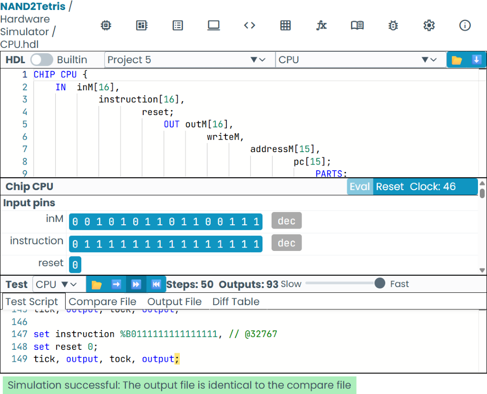
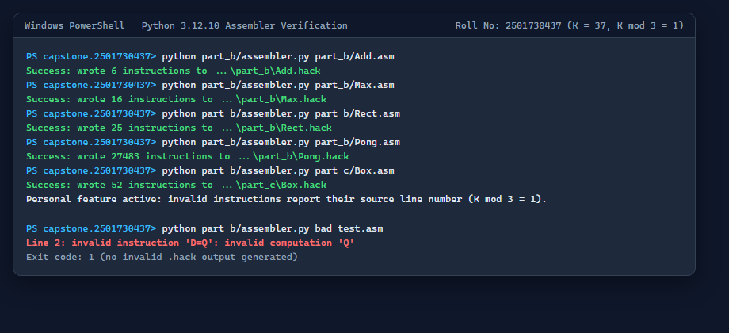

# Capstone Project Report: Make the Computer Draw a Box

**Course:** Nand to Tetris – I (ETCCNT301)  
**Institution:** School of Engineering & Technology, K.R. Mangalam University  
**Student Name:** Himanshu Yadav  
**Roll Number:** 2501730437  
**Personal Number (K):** 37  

---

## 1. Aim & Personal Parameters

The objective of this capstone project is to build the Hack computer platform from hardware logic chips, write a two-pass Hack assembler in Python, and implement an interactive Hack assembly program (`Box.asm`) that draws a black rectangle on the screen while any key is pressed and clears it when the key is released.

From Roll Number **2501730437**, the last two digits give **K = 37**:
- **Assembler Extra Feature (`K mod 3`):** `37 mod 3 = 1` — For any invalid assembly line, the assembler prints a clear error message including the source line number (e.g., `Line 2: invalid instruction 'D=Q': invalid computation 'Q'`) and exits cleanly instead of crashing.
- **Box Vertical Start Row (`K`):** Row **37** (`0`-indexed from the top of the 256-row Hack display).
- **Box Height:** **20** rows (rows 37 through 56).
- **Box Width (`16 × ((K mod 4) + 1)`):** `37 mod 4 = 1`, so width = `16 × (1 + 1) = 32` pixels from the left edge (2 consecutive 16-bit screen words per row).
- **Starting Screen Memory Address:** `SCREEN = 16384`, and each row occupies `32` words (`512 pixels / 16 bits`). Therefore, row 37 begins at `16384 + (32 × 37) = 17568`.

---

## 2. Part A — Build the Hack Computer (`CPU.hdl`, `Memory.hdl`, `Computer.hdl`)

The Hack hardware architecture integrates the combinational and sequential chips from earlier labs into three top-level modules in `part a/`:

- **`CPU.hdl`**: Decodes 16-bit instructions (`instruction[15] == 0` for A-instructions, `1` for C-instructions), manages `ARegister` and `DRegister`, selects between `A` and `inM` via `Mux16`, executes the `ALU` (`zx, nx, zy, ny, f, no`), asserts `writeM` when `instruction[15] & instruction[3]`, evaluates jump flags (`ngOut`, `zrOut`, positive) to drive `PC`, and outputs `addressM` and `pc`.
- **`Memory.hdl`**: Routes the 15-bit `address` across `RAM16K` (`0x0000–0x3FFF`), `Screen` (`0x4000–0x5FFF`), and `Keyboard` (`0x6000`) using `DMux4Way` (with `Or` combining `ramLoad1` and `ramLoad2`) and `Mux4Way16`.
- **`Computer.hdl`**: Connects `ROM32K(address=pc, out=instruction)`, `CPU`, and `Memory` in a closed fetch–decode–execute loop controlled by `reset`.

**Built-in Chips Note:** Per Project 5 specifications, `ARegister`, `DRegister`, `Screen`, `Keyboard`, and `ROM32K` use the simulator's built-in chips. When verified in the Nand2Tetris Web IDE (`CPU.tst`), standard sub-chips (`ALU`, `PC`, `Mux16`, `And`, `Or`, `Not`) also resolve to the Web IDE built-in implementations unless local lab HDL files (`01 (1)/`, `02/`, `03/`) are loaded into the same project workspace.

### Part A Test Results & Screenshots

1. **`CPU.tst` — Passed** (Verified in Nand2Tetris Web IDE: `Steps: 50`, `Outputs: 93`, `Clock: 46` — `Simulation successful: The output file is identical to the compare file`).  
   

2. **`Memory.tst`** — *[Pending screenshot: run `Memory.tst` in Hardware Simulator and insert passing screenshot here]*
3. **`ComputerAdd.tst`** — *[Pending screenshot: run `ComputerAdd.tst` in Hardware Simulator and insert passing screenshot here]*
4. **`ComputerMax.tst`** — *[Pending screenshot: run `ComputerMax.tst` in Hardware Simulator and insert passing screenshot here]*
5. **`ComputerRect.tst`** — *[Pending screenshot: run `ComputerRect.tst` in Hardware Simulator and insert passing screenshot here]*

---

## 3. Part B — Two-Pass Python Assembler (`assembler.py`)

`part_b/assembler.py` translates `.asm` source into 16-bit `.hack` machine code using two passes:
1. **Pass 1 (`clean_source` + symbol collection):** Iterates over `enumerate(source.splitlines(), 1)` to preserve exact source line numbers, strips `//` comments and blank lines, validates `(LABEL)` declarations, checks for duplicate or reserved labels, and records each label's ROM address.
2. **Pass 2 (binary encoding):** Encodes `@value` A-instructions (resolving numeric constants, predefined symbols `R0–R15`, `SP`, `LCL`, `ARG`, `THIS`, `THAT`, `SCREEN=16384`, `KBD=24576`, labels, and allocating new variables sequentially from RAM `16`) and `dest=comp;jump` C-instructions (`111` + 7-bit `comp` + 3-bit `dest` + 3-bit `jump`).
3. **Personal Feature (`K mod 3 = 1`):** Any malformed instruction, unknown `dest`/`comp`/`jump` mnemonic, out-of-range constant (`> 32767`), or invalid symbol raises `AssemblyError(f"Line {line_no}: invalid instruction '{code}': {exc}")` and exits with code `1` without writing corrupt `.hack` output.

### Part B Verification Output
- Assembling the official benchmark programs in `part_b/` and `part_c/Box.asm` with Python 3.12.10 succeeded:
  - `Add.asm` → `6` instructions (`part_b/Add.hack`)
  - `Max.asm` → `16` instructions (`part_b/Max.hack`)
  - `Rect.asm` → `25` instructions (`part_b/Rect.hack`)
  - `Pong.asm` → `27483` instructions (`part_b/Pong.hack`)
  - `Box.asm` → `52` instructions (`part_c/Box.hack`)
- Assembling `bad_test.asm` (`@2` on line 1, `D=Q` on line 2) printed: `Line 2: invalid instruction 'D=Q': invalid computation 'Q'` (exit code `1`).

- **Official Benchmark Comparison (`Add.asm`, `Max.asm`, `Rect.asm`, `Pong.asm`):** *[Pending: compare generated `.hack` files against the official Nand2Tetris assembler and insert diff/comparison screenshot here]*

---

## 4. Part C — Interactive Box Program (`Box.asm` & `Box.hack`)

`part_c/Box.asm` polls the memory-mapped keyboard register `@KBD` (`24576`) in an infinite `(START)` loop:
- **Key Pressed (`M != 0`):** Branches to `(DRAW)`, initializes pointer `R13 = 17568` (`SCREEN + 32 × 37`) and row counter `R14 = 20`. In `(DRAW_LOOP)`, it writes `-1` (`1111111111111111`, 16 black pixels) to `RAM[R13]` and `RAM[R13 + 1]` (total 32 pixels wide), adds `32` to `R13` to step down one row, and decrements `R14` until all 20 rows are drawn.
- **Key Released (`M == 0`):** Branches to `(CLEAR)` and writes `0` (16 white pixels) across the exact same `2 × 20 = 40` screen words before returning to `(START)`.

`Box.asm` was compiled using our own `part_b/assembler.py` into `part_c/Box.hack` (52 instructions).

- **CPU Emulator Screenshot (Key Pressed — 32×20 black box at row 37):** *[Pending screenshot: load `Box.hack` in CPU Emulator, press any key, and insert screenshot here]*
- **CPU Emulator Screenshot (Key Released — box cleared):** *[Pending screenshot: release key in CPU Emulator and insert screenshot here]*

---

## 5. One Mistake Fixed During Development

While calculating the vertical position of the box in `Box.asm`, a direct pitfall is adding the row number `K = 37` directly to `SCREEN` (`16384 + 37 = 16421`), which places the pixels near the middle of row 1 instead of the left edge of row 37. Because each horizontal row on the 512×256 Hack display consists of `512 / 16 = 32` consecutive 16-bit memory words, advancing down by `r` rows requires multiplying by `32`. Updating the base pointer in `Box.asm` to `16384 + (32 × 37) = 17568` and incrementing `R13` by `32` after writing the two horizontal words (`M=-1`, `A=A+1`, `M=-1`) on each iteration fixed the vertical alignment and row stride so all 20 rows render cleanly at row 37 along the left edge.
